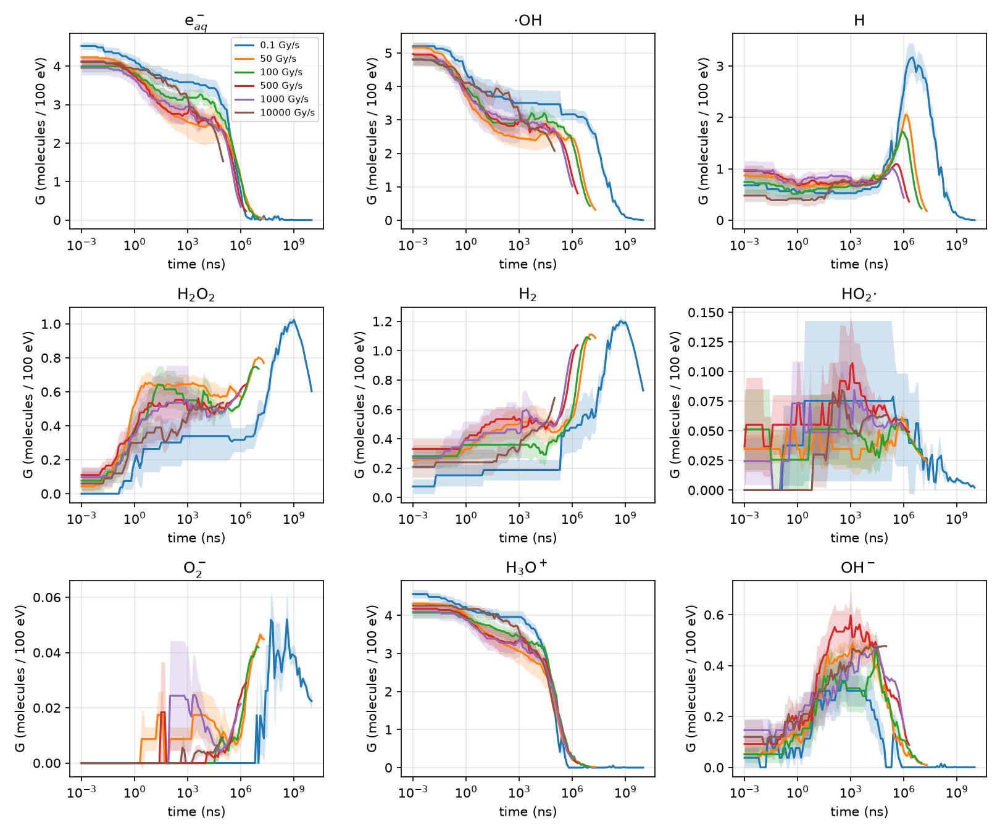
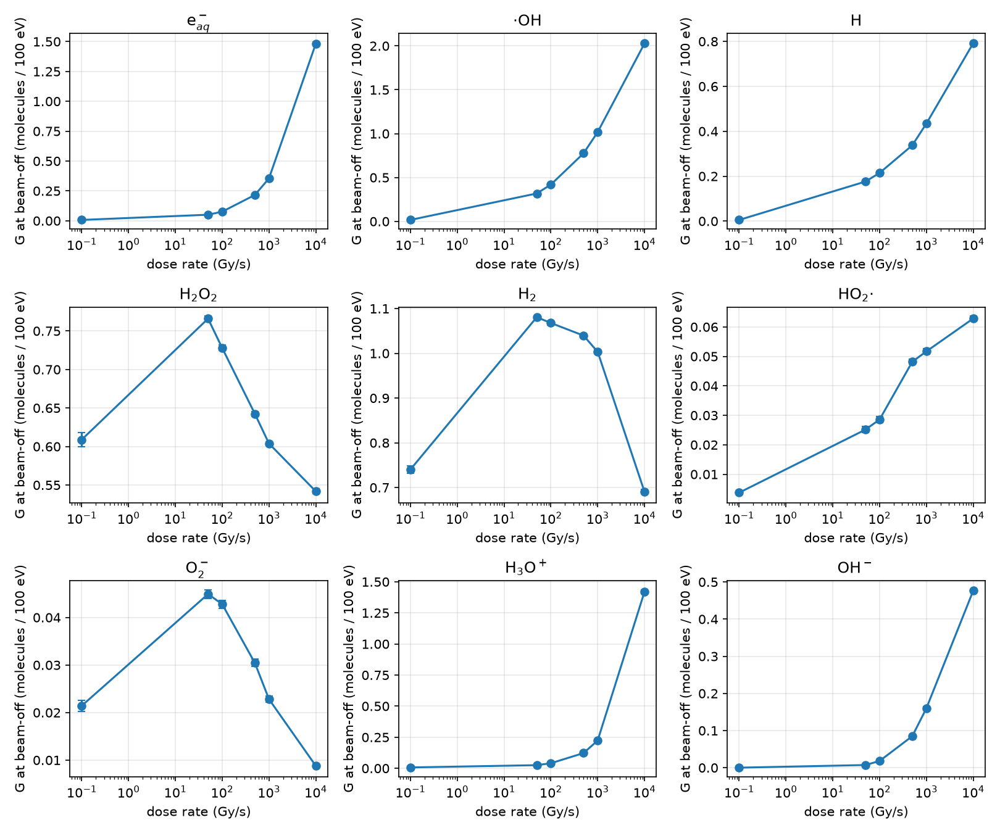

# Dose-rate study: G-values in a 4 µm water box up to 1 Gy (0.1 to 10⁴ Gy/s)

## Question

How do the radiolysis G-values of pure water change with the dose rate when a 4 µm water box is irradiated by a continuous 500 keV electron beam up to 1 Gy, for rates from 0.1 Gy/s to 10⁴ Gy/s?

## Method

- **Tool:** `examples/dose-rate-study` (`capture`, then `history` in `doseCutoff` mode), built against the patched Geant4 11.4.3 install. Design: `docs/adr/0011-reflecting-box-for-dose-rate-study.md`; commands and file formats: `examples/dose-rate-study/README.md`.
- **Capture:** each 500 keV e⁻ starts 1 nm inside the −z face of a 20 µm water world, at a uniform random (x, y) over the face of the 4 µm box, and travels along +z. The molecules inside the box at 1 ps and the energy deposited in the box form one packet.
- **Packet library:** 2400 packets from 12 parallel captures (`spike/library`). 215 crossings that missed the box were skipped and count as 0 eV, so the hit fraction is 0.918. The mean deposit is 653 eV per packet, or 600 eV per launched primary. The library holds 3.93 Gy in total.
- **Box:** 4 µm side (half side 2 µm), mass 6.4e-14 kg, reflecting walls. 1 Gy is 3.99e5 eV, about 600 packets.
- **Physics and chemistry:** `G4EmDNAPhysics_option2`; the dnachem-min `PureWater` reaction network (no O₂); pH 7 acid-base buffer as bulk species; IRT_syn only, no mesoscopic stage.
- **Arrivals:** a homogeneous Poisson process at the launch rate Ḋ·m / ⟨E per launched primary⟩, thinned by the hit fraction. Each arrival injects the next library packet. It is activated 1 ps after its arrival time. Each run starts at a random library offset.
- **Dose cutoff:** scheduling stops at the first arrival whose cumulative box deposit reaches 1 Gy, so the overshoot is less than one track (mean final dose 1.001 to 1.003 Gy). Beam-off is 1 ps after the last activation, and the chemistry stops there. There is no post-beam relaxation.
- **Grid:** one absolute log grid from 1 ps at 10 points per decade, the same for every rate, plus one extra row at each run's beam-off.
- **Steady-state stop:** enabled (50-sample windows, 5 % tolerance). It never fired (see below).
- **Estimator:** G is a ratio estimator over the realizations of a rate, G = 100·ΣN/ΣE. The SE comes from the delta method. Two normalisations are given:
  - `G_cum(t)` divides by the deposit up to t (the cumulative dose).
  - `G_final(t)` divides by the deposit at beam-off.

  At beam-off the two are equal.

## Runs and cost

| Rate (Gy/s) | Realizations used | Mean arrivals | Mean beam-off | Mean wall time per run (s) | Peak memory (MB) |
|---|---|---|---|---|---|
| 0.1 | 6 (7 run, 1 crashed) | 600 | 9.57 s | 31228 | 238 |
| 50 | 10 | 592 | 19.5 ms | 2714 | 251 |
| 100 | 10 | 608 | 10.2 ms | 2875 | 253 |
| 500 | 10 | 621 | 2.03 ms | 3707 | 260 |
| 1000 | 10 | 606 | 0.985 ms | 4342 | 270 |
| 10⁴ | 10 | 605 | 97.6 µs | 6329 | 300 |

- The runs ran concurrently on one 20-logical-core workstation, so the wall times include some contention.
- **Total production wall time** (summed over runs):
  - 1 Gy set: 2.0e5 s for rates 50 to 10⁴ Gy/s, plus 1.9e5 s for the 6 good 0.1 Gy/s runs. The crashed run used another 2.6e4 s.
  - 0.5 Gy side set: 3.6e4 s.
  - Snapshot runs: 3.0e4 s, plus 3.1e4 s for the crashed 0.1 Gy/s, 1 Gy snapshot run.
- **Spike (ticket 04):** 6 histories with a 45 min cap, all truncated at 2701 s, peak memory 238 to 282 MB, plus one 26 s snapshot run. Its full-cost estimates were 2.8e3 s (50 Gy/s) to 5.1e3 s (10⁴ Gy/s), which production matched within 25 %. For 0.1 Gy/s at 1 Gy it estimated 1.7e4 s, but production took 3.1e4 s. That estimate was a stated lower bound: runs slow down as molecules accumulate.
- The cost per history grows with the dose rate above 100 Gy/s (more live molecules at once). At 0.1 Gy/s it is set by the 10 s of simulated time.

## Results

### G(t)



`figures/dose-rate-study/g_vs_time_cum.png`: G_cum(t), one panel per species, one line per rate, ±1 SE band. Each line ends at that rate's beam-off. `g_vs_time_final.png` is the same plot normalised by the final dose.

- Up to about 1 µs, the curves of all rates overlap within their noise. At early times only a few tracks have arrived, so those points are noisy, most of all at 0.1 Gy/s, where the first point is set by one or two tracks.
- At every rate, e_aq⁻, ·OH and H₃O⁺ fall to near zero within about 1 ms of their track. So by beam-off, the radicals left at low rates come only from the most recent tracks. At high rates many tracks overlap in time, so more radicals are alive at beam-off.
- At 0.1 Gy/s, H₂O₂ and H₂ peak at about 1 s (G ≈ 1.0 and 1.2) and then decrease up to beam-off at 9.6 s. H also rises to G ≈ 3 around 1 ms before decaying. Which reactions consume H₂ and H₂O₂ over seconds was not analysed here. A chain such as ·OH + H₂ → H, then H + H₂O₂ → ·OH, would fit, but this is a hypothesis.

### G at beam-off



`figures/dose-rate-study/g_vs_rate_cum.png`: G at beam-off (1 Gy) vs dose rate, ±1 SE.

G at beam-off (molecules / 100 eV, ± SE). The beam-off time differs by five orders of magnitude between rates (9.6 s to 98 µs), so these values mix the dose-rate effect with the chemistry time.

| Species | 0.1 Gy/s | 50 Gy/s | 100 Gy/s | 500 Gy/s | 1000 Gy/s | 10⁴ Gy/s |
|---|---|---|---|---|---|---|
| e_aq⁻ | 0.0070 ± 0.0020 | 0.0506 ± 0.0044 | 0.0759 ± 0.0077 | 0.2159 ± 0.0059 | 0.3548 ± 0.0123 | 1.4816 ± 0.0130 |
| ·OH | 0.0169 ± 0.0030 | 0.3183 ± 0.0086 | 0.4193 ± 0.0118 | 0.7763 ± 0.0080 | 1.0180 ± 0.0155 | 2.0277 ± 0.0143 |
| H | 0.0053 ± 0.0010 | 0.1761 ± 0.0027 | 0.2145 ± 0.0043 | 0.3375 ± 0.0069 | 0.4344 ± 0.0046 | 0.7917 ± 0.0047 |
| H₂O₂ | 0.6089 ± 0.0095 | 0.7660 ± 0.0035 | 0.7280 ± 0.0036 | 0.6424 ± 0.0032 | 0.6039 ± 0.0026 | 0.5419 ± 0.0034 |
| H₂ | 0.7403 ± 0.0079 | 1.0808 ± 0.0027 | 1.0678 ± 0.0046 | 1.0396 ± 0.0045 | 1.0034 ± 0.0044 | 0.6906 ± 0.0048 |
| HO₂· | 0.0038 ± 0.0004 | 0.0252 ± 0.0011 | 0.0286 ± 0.0010 | 0.0482 ± 0.0008 | 0.0517 ± 0.0010 | 0.0628 ± 0.0009 |
| O₂⁻ | 0.0214 ± 0.0012 | 0.0449 ± 0.0009 | 0.0428 ± 0.0008 | 0.0304 ± 0.0008 | 0.0228 ± 0.0007 | 0.0088 ± 0.0004 |
| H₃O⁺ | 0.0071 ± 0.0020 | 0.0253 ± 0.0038 | 0.0407 ± 0.0074 | 0.1226 ± 0.0043 | 0.2238 ± 0.0103 | 1.4198 ± 0.0163 |
| OH⁻ | 0.0001 ± 0.0001 | 0.0072 ± 0.0004 | 0.0181 ± 0.0015 | 0.0849 ± 0.0028 | 0.1600 ± 0.0048 | 0.4763 ± 0.0028 |

- The radicals (e_aq⁻, ·OH, H), H₃O⁺, OH⁻ and HO₂· increase steadily with the rate. This follows from the shorter beam: more tracks are still young at beam-off.
- From 50 to 10⁴ Gy/s, H₂O₂ falls from 0.77 to 0.54 and H₂ from 1.08 to 0.69. O₂⁻ peaks at 50 to 100 Gy/s.
- At 0.1 Gy/s, H₂O₂ (0.61) and H₂ (0.74) are below their 50 Gy/s values, because of the slow decrease after 1 s (above).
- At beam-off, the last track has been active for only 1 ps. At 1 Gy (about 600 tracks), one fresh track contributes about G/600 of its initial yield, about 0.007 for e_aq⁻. This is the order of the 0.1 Gy/s radical values, so those values reflect mostly the last track.

Data: `.scratch/tests/2026-11-15__dose-rate-study/prod/analysis/1Gy/`.
- `gvalues_time.csv`: all rates on the common grid.
- `gvalues_time_rate<r>.csv`: one file per rate.
- `gvalues_beamoff.csv`: the beam-off values.

All of them have G_cum, SE_cum, G_final, SE_final and the realization count.

### Steady-state stop

The steady-state stop (one sample per arrival, 50-sample windows, every species within 5 % of the previous window mean) did not fire in any of the 66 production and snapshot histories (`steadyState.reached = false` in every ledger). No row is extrapolated. H₂O₂ and H₂ keep accumulating at every rate up to 1 Gy, so a criterion over all species is not met. A species-selective criterion would be needed to stop earlier.

### Side result: 0.1 Gy/s at 0.5 Gy

4 realizations (`plan_lo`), mean beam-off 5.20 s, mean dose 0.501 Gy. Data: `prod/analysis/lo_0.5Gy/`.

| Species | G at beam-off, 0.5 Gy runs | G at 5.01 s, 1 Gy runs (n = 6) |
|---|---|---|
| e_aq⁻ | 0.0209 ± 0.0065 | 0.0003 ± 0.0003 |
| ·OH | 0.0404 ± 0.0069 | 0.0193 ± 0.0018 |
| H | 0.0165 ± 0.0011 | 0.0128 ± 0.0021 |
| H₂O₂ | 0.7880 ± 0.0019 | 0.7628 ± 0.0056 |
| H₂ | 0.9145 ± 0.0051 | 0.8988 ± 0.0061 |
| H₃O⁺ | 0.0210 ± 0.0062 | 0.0000 ± 0.0000 |
| O₂⁻ | 0.0244 ± 0.0019 | 0.0275 ± 0.0016 |

- The right column is the closest common-grid point of the 1 Gy runs, before their beam-off.
- The radical differences come from the fresh track at beam-off (above). At 0.5 Gy it weighs twice as much as at 1 Gy.
- H₂O₂ and H₂ differ by 4.3 and 2.0 SE. The grid point is 0.19 s earlier, and the realizations and packets are different. The cause of the difference was not studied.

## Movies

One snapshot history per rate was run with `snapshots = true` (`prod/snap_1Gy`, `prod/snap_lo`). Two of them were made into GIFs with `scripts/movie.py`. Each shows six species (e_aq⁻, ·OH, H, H₂O₂, H₂, H₃O⁺), at most 3000 molecules drawn per frame (random subsample), at 3 frames per decade of time up to beam-off:

- [`figures/dose-rate-study/movie_10000Gy_s.gif`](figures/dose-rate-study/movie_10000Gy_s.gif): 10⁴ Gy/s, 24 frames, 0.25 MB.
- [`figures/dose-rate-study/movie_50Gy_s.gif`](figures/dose-rate-study/movie_50Gy_s.gif): 50 Gy/s, 32 frames, 0.34 MB.

Command:

```
python examples/dose-rate-study/scripts/movie.py <run>/snapshots.h5 --out movie.gif \
  --species "e_aq^-1" "°OH^0" "H^0" "H2O2^0" "H_2^0" "H3O^1" \
  --max-points 3000 --box-half-side-nm 2000 --dpi 60 --fps 3
```

## Limitations

- **Counter crashes at large times.** Two 0.1 Gy/s, 1 Gy histories aborted in Geant4's molecule counter:
  - `r0.1_003` (production, excluded from the 0.1 Gy/s results) stopped at 8.79 s with `TIME_DONT_MATCH` in `G4VUserMoleculeCounter::AddMolecule`.
  - The 0.1 Gy/s, 1 Gy snapshot run (`snap_lo1Gy`) stopped at 9.78 s with `RETURN_TO_THE_FUTUR` in `RemoveMolecule`.

  In both cases the two times compared print the same.
  - **Verified in the 11.4.3 source** (`G4VUserMoleculeCounter.hh`, `G4MoleculeCounterTimeComparer.cc`): both checks fail when the new time is before the last recorded counter time by more than the comparer precision. This example sets that precision to a fixed 1 fs (`kCounterPrecisionNs`, `HistoryMain.cc`), not to the Geant4 default of 1 ps.
  - **Arithmetic:** times are doubles in ns. Above 2³³ ns (8.59 s), one ulp is 2⁻¹⁹ ns (1.9 fs), which is larger than the 1 fs tolerance. Two times one rounding step apart can then fail the check. Both crashes happened above 8.59 s.
  - **Hypothesis:** this is the cause. It is supported by the arithmetic and the crash times, but has not been reproduced. 6 of 7 histories passed 8.59 s without a crash.
  - Raising the counter precision, or measuring times from a later origin, would probably avoid the crash. Neither was tested.
- **Uncompressed snapshots.** The vcpkg HDF5 used has no gzip filter, so `snapshots.h5` is written uncompressed (`snapshots.compressed = false`): 0.2 to 1.0 MB per run here.
- **Shared packets.** All realizations draw from the same 2400-packet library, about 600 packets each, from random offsets. Realizations of one rate, and of different rates, therefore reuse packets. The SE treats realizations as independent, so it may be somewhat low, and the differences between rates are partly correlated.
- **No post-beam relaxation.** The chemistry stops at beam-off. The rates are compared at their own beam-off times (98 µs to 9.6 s), not at a common time after the beam.
- **Reflecting walls.** Molecules cannot leave the 4 µm box, and the box sees no tracks or chemistry from outside it. Inter-track effects are those of an isolated box, not of a larger irradiated volume.
- **0.1 Gy/s statistics.** Only 6 realizations, and the early-time points are dominated by one or two tracks.

## Reproduction

```
python examples/dose-rate-study/studies/analyze.py --plan prod/plan_1Gy/plan.json --plan prod/plan_lo1Gy/plan.json \
  --out prod/analysis/1Gy --allow-partial      # skips r0.1_003 (no passing ledger)
python examples/dose-rate-study/studies/analyze.py --plan prod/plan_lo/plan.json --out prod/analysis/lo_0.5Gy
python examples/dose-rate-study/studies/plot.py --data prod/analysis/1Gy --out docs/dose-rate/figures/dose-rate-study \
  --norm cum --ncols 3 --species "e_aq^-1" "°OH^0" "H^0" "H2O2^0" "H_2^0" "HO_2°^0" "O_2^-1" "H3O^1" "OH^-1"
```

(`prod` = `.scratch/tests/2026-11-15__dose-rate-study/prod`; repeat `plot.py` with `--norm final` for the final-dose plot.)
